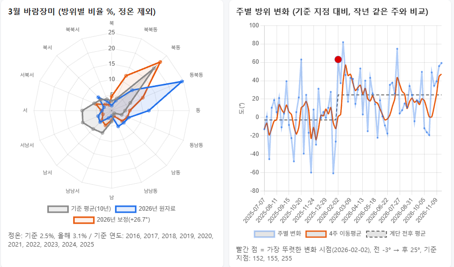

# kma-windrose: 바람장미 특이점 탐지

기상청 ASOS 시간자료로 지점별 월별 바람장미(풍향·풍속 계급별 빈도)를 만들고,
올해 각 달을 직전 10년 같은 달과 비교해 특이점을 찾는 프로그램입니다.
특이점이 실제 바람의 변화인지 관측 계통(센서·설치·작업)의 변화인지 구분하는 데 중점을 둡니다.



## 무엇을 하나

1. **수집·정리**: 기상청 API허브 ASOS 시간자료(기간 조회)를 연도별로 받아 SQLite에 적재하고 결측·물리 규칙을 정리합니다.
2. **월별 바람장미 집계**: 정온(0.4 m/s 이하)과 16방위 × 풍속 4계급(0.5~3.3, 3.4~7.9, 8.0~13.8, 13.9 이상) 빈도를 월별로 저장합니다.
3. **품질 표시(QC)**: 같은 달 기준 대비 정온 비율 증가·감소, 풍속 0 지속(8시간 이상), 같은 방위 장시간 지속(고착 후보), 자료 부족을 월별로 표시합니다.
4. **특이점 판정**: Jensen-Shannon 거리로 올해와 기준 평균의 차이를 구하고, 기준 연도끼리의 거리(leave-one-out)와 순위를 비교합니다. 정온·16방위·강풍 비율 중 크게 벗어난 칸(z ≥ 3, 차이 ≥ 2%p)을 원인 칸으로 보여줍니다.
5. **관측 계통 변화 진단**
   - 방위 회전 테스트: 분포를 몇 도 돌리면 평소와 가장 비슷해지는지 추정
   - 지점 쌍 풍향 차이: 인접 지점과의 같은 시각 풍향 차이로 어느 지점이 언제 바뀌었는지 분리
   - 주 단위 계단 탐지: 작년 같은 주 대비 변화에서 계단 시점을 자동으로 찾고 작업 이력과 대조
6. **회전 보정 후 재판정**: 작업 이력과 일치하는 계단이 있으면 이후 달의 방위를 보정한 뒤 다시 판정합니다.
7. **결과**: 통합 보고서(Markdown, JSON)와 웹 화면(FastAPI, Chart.js)

## 검증

- 시간자료의 풍향 값은 헤더에 "36방위"로 표기되지만 실제로는 16방위를 36 눈금으로 환산한 17개 코드(0 = 정온)임을 자료로 확인하고 변환표를 만들었습니다.
- 한 지점의 2025년 연간, 2026년 1~10월 집계표가 기상자료개방포털 바람장미 CSV와 모든 칸에서 소수점 첫째 자리까지 일치했습니다.
- 지점 쌍 비교로, 작업 이력이 알려진 다른 지점의 장비 교체 시점이 해당 지점 단독 변화로 분리되는 것을 확인했습니다.

## 사례 (지점 비공개)

2026년 한 해안 지점에서 3~10월이 연속으로 "특이"로 판정되었습니다.
회전 테스트와 인접 지점 비교 결과, 2026년 2월 초부터 풍향 분포가 약 27° 시계 방향으로 회전한 형태였고,
주 단위 계단 시점이 (비공개) 작업 이력과 일치해 관측 계통 변화로 분류했습니다.
보정 후에는 대부분의 달이 평소 범위로 돌아왔고, 3월과 7월만 평소 변동의 가장자리 수준으로 남았습니다.

## 실행

```bash
python3 -m venv .venv && source .venv/bin/activate
pip install -r requirements.txt
cp .env.example .env              # KMA_AUTH_KEY=발급받은_키 입력
python collector/fetch_asos_hourly.py 159 2015 2025
python collector/fetch_recent.py 159
python collector/load_asos_to_db.py
python collector/clean_asos.py
python src/report.py 159 2026     # reports/159_2026.md, .json 생성
uvicorn app.main:app --port 8001  # http://localhost:8001
```

작업 이력은 `config/maintenance.csv`(형식: `config/maintenance.example.csv`)에 두며 저장소에 올리지 않습니다.

## 폴더 구조

| 경로 | 내용 |
|---|---|
| `collector/` | 수집, 적재, 정리 |
| `src/windrose_core.py` | 방위 코드 변환표, 풍속 계급, DB 읽기 |
| `src/wr_lib.py` | 분포 거리, 회전, 판정, 지점 비교, 계단 탐지 공통 함수 |
| `src/build_monthly.py`, `src/qc_wind.py` | 월별 집계, 품질 표시 |
| `src/report.py` | 통합 보고서 |
| `src/` 기타 | 탐색 단계 스크립트(회전 테스트, 지점 쌍 비교, 주 단위 비교 등) |
| `app/`, `web/` | 웹 서버, 화면 |

## 한계

- 풍향이 22.5° 단위로만 기록돼 회전 추정 정밀도는 ±6° 정도입니다.
- 회전 보정은 방위 축을 평행 이동시키는 단순 모형입니다. 오차가 방위에 따라 다르면 보정 잔여가 남습니다.
- 기준이 10개 연도라 순위 1은 우연으로도 달마다 약 9% 확률로 나옵니다.
- 인접 지점 비교는 기준 지점 자체의 변화(장비 교체, 주변 환경 변화)에 영향을 받습니다.
- 주 단위 값은 잡음(±25~30°)이 커서 통계만으로는 급격한 계단과 몇 달에 걸친 변화를 가르기 어렵습니다. 그래서 작업 이력과 일치할 때만 자동 보정합니다.

## 보안

인증키는 `.env`, 작업 이력은 `config/maintenance.csv`, 결과는 `reports/`에 두며 모두 `.gitignore`로 제외합니다.
